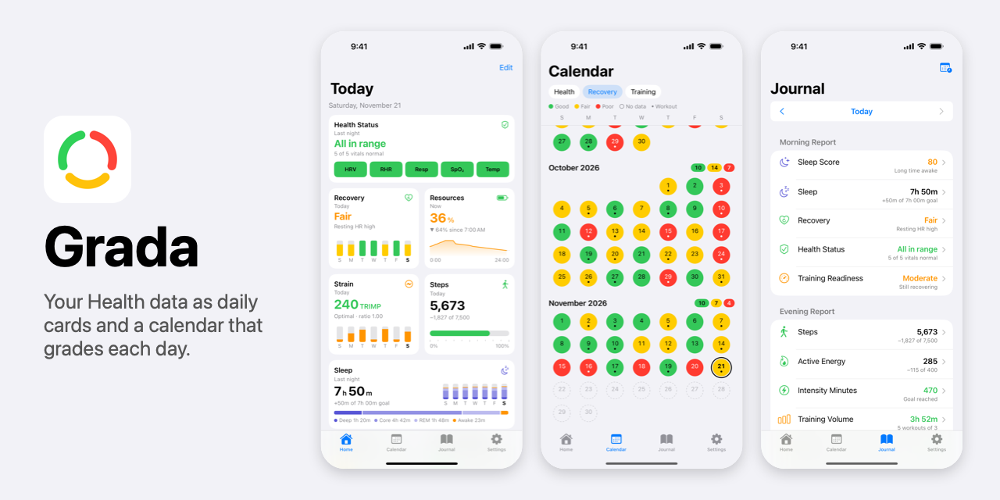

# Grada

**Turn your Health data into daily cards and a calendar that grades each day.**



Grada is an iPhone and iPad app that reads Apple Health and turns it into daily cards, a graded calendar, and morning and evening reports. Every calculation runs on the device, and each metric names the research it rests on.

## Features

| Area | What it does |
|---|---|
| **Home** | Cards for recovery, sleep, heart and vitals, activity, training and body, for today or the last 7 days where both apply. First launch starts with a Health, Recovery or Training set; add, remove and reorder cards from there. |
| **Calendar** | Colors days by Health, Recovery or Activity (steps against your Steps goal), draws each day's sports under Workouts, or shows your Cycle. Each day opens a sheet. |
| **Detail screens** | Each metric's trend, breakdown, meaning and inputs. Some add today's advice: steps left as walking minutes, intensity minutes left this week, today's training session, a bedtime for your usual weekday wake-up (at most an hour later on weekends) and your own sleep need, a regular sleep schedule when sleep consistency is poor, or easing off when resting heart rate, HRV or training load is out of range. |
| **Goals and journal** | Goal presets that adjust weekly, and a daily journal of habits such as alcohol, caffeine, naps or travel, with tags suggested from health data. |
| **Reports** | A morning report that plans the day (focus and a rest, easy, moderate or hard training suggestion) and an evening report that checks in on it, says what drained and restored Resources, what the week still needs and tonight's bedtime. Follow-ups are judged from health data only, with no scores or streaks. Journal also has a month summary and shows how alcohol and caffeine affect the next night. |
| **Notifications** | **Settings > Profile > Sleep Schedule** sends both reports, plus an afternoon check-in only when a goal is behind but still reachable. |
| **Widgets** | Any single-value card, such as Recovery or Training Readiness, on the Home Screen (small, medium) or Lock Screen (circular, rectangular). Touch and hold the widget > **Edit Widget** to pick a card. It matches the Home card, updates after each Apple Health import, and clears at midnight until the next one. |
| **Cycle** | For Female users, Calendar shows period days logged to Apple Health (Cycle Tracking, Clue, Flo…), the cycle day and sleeping wrist temperature. After 3 cycles it predicts the next period as a range. Ovulation is marked only from a positive LH test or a sustained temperature rise (three-over-six rule), never ahead. There is no fertile window; it is not for birth control or pregnancy planning, and Grada only reads this data and never stores it. |

Grada follows the device language, or the one picked in Settings › Appearance › Language: English, Spanish, Simplified Chinese, Hindi, Portuguese, Russian, French, German or Italian.

## Data

Grada reads Apple Health and never writes to it. Garmin, Suunto and other devices reach it through their own Apple Health sync. Two optional imports fill what a sync leaves out, such as Garmin's overnight HRV; Apple Health data always comes first.

| Source | Where | What it reads |
|---|---|---|
| **FIT files** | **Settings > Import > FIT Files** | Files or folders (for example an unzipped Garmin export): workouts, sleep stages, overnight HRV and resting heart rate, read offline on the device. Files fill only days Apple Health lacks, re-importing changes nothing, and unreadable files are named. |
| **Garmin Connect** | **Settings > Import > Garmin Connect** | Daily summaries, sleep, overnight HRV and workouts, using your own Personal API key, at most every 15 minutes. The key stays in the Keychain and goes only to Garmin. |

**Settings > Data Source** lists each data type with its source apps and devices and the last day each sent data; detail screens name them under "Data from". When several apps record the same readings, Grada picks the one with the most days last month (for sleep, one app per night).

## Privacy

- All calculations run on the device. Grada has no accounts, analytics or advertising and sends your data to no one; its only network calls go to Garmin, if you connect Garmin.
- Health data stays on the device and never goes to iCloud, as App Review requires.
- App data (home layout, goals, journal) lives in a separate store that can sync through your private iCloud. That sync is built but switched off until [#20](https://github.com/TokenCemetery/Grada/issues/20).
- Grada isn't a medical device. Settings and every detail screen say so, and the Illness suggestion says it isn't a diagnosis.

Full details are in the [privacy policy](PRIVACY.md), also linked from Settings.

## Scientific basis

Every calculated metric rests on published research. Each detail screen lists its sources with links and marks anything no study has set as "Grada's estimate".

- **Recovery and HRV:** overnight HRV against your own baseline, the method from HRV-guided training studies.
- **Sleep Score:** the National Sleep Foundation's sleep quality consensus.
- **Strain:** Edwards' training load and the acute:chronic workload ratio, plus Foster's training monotony and strain over 7 days; weeks with monotony above 2 get a suggestion to mix hard and easy days. On iOS 18 and later, workouts rated for effort in Apple Health (or estimated by Apple Watch) show their session-RPE load (rating × minutes, Foster et al. 2001), compared with their heart rate load.
- **Health Age:** published mortality risks for VO₂ max, resting heart rate, steps, sleep and exercise.
- **Weight:** latest weight with BMI and WHO adult class and the 30-day trend, in kilograms or pounds; the detail screen adds body fat and lean body mass, and notes that BMI doesn't tell fat from muscle.
- **Blood Pressure:** the latest day's cuff reading (averaged when there were several) and the 30-day average, coloured by the 2017 ACC/AHA categories; readings over a week old show uncoloured. Grada estimates nothing here.
- **Mobility:** iPhone walking speed averaged over 7 days, with Apple's Walking Steadiness class labelled as Apple's. From age 65 the average is coloured by Studenski et al.'s survival bands (1.0, 0.8 and 0.6 m/s) as a fitness marker, not a diagnosis.
- **Heart Rate Recovery:** the heart rate drop in the minute after a workout, from Apple Watch or the heart rate around the workout's end, averaged over your last 3 workouts in 30 days because one session is noisy; the detail screen charts each workout day with a moving average. An average drop of 12 bpm or less is marked, Cole et al.'s cut-off, as a fitness marker.

Resources, an all-day energy estimate, has no published method behind it and says so.

## Build and run

**Requirements:** Xcode 27.2 or later (the project uses the Xcode 27 `project.xcproj` format). The app runs on iOS 17 or later, on iPhone and iPad.

1. Open `Grada.xcodeproj` and run the `Grada` scheme on an iPhone simulator.
2. Allow Apple Health access when asked.
3. Open **Settings > Simulator Data** and tap **Add 90 Days of Sample Data**. This screen appears only in Debug builds on the simulator.

Home and Calendar then fill with the sample days.

To skip Apple Health entirely, add the `-SampleData` launch argument to the scheme (Debug builds only); the app then uses built-in sample data.

### Run the tests

The unit tests check English text, so the shared `Grada` scheme runs them in English whatever the simulator's language, including ⌘U in Xcode. From the repository root, the same command CI uses also pins the region:

```bash
xcodebuild test -project Grada.xcodeproj -scheme Grada -destination "platform=iOS Simulator,name=iPhone 15" -only-testing:GradaTests -testLanguage en -testRegion US CODE_SIGNING_ALLOWED=NO
```

Replace `iPhone 15` with any simulator from `xcrun simctl list devices available`. The command ends with `** TEST SUCCEEDED **`. CI ([build.yml](.github/workflows/build.yml)) runs it on every push to `main` and every pull request; UI tests in `GradaUITests` run only locally.

## Contributing

Bugs and feature requests go in [GitHub issues](https://github.com/TokenCemetery/Grada/issues); search open and closed issues first. Each issue carries one type and one priority label from [labels.yml](.github/workflows/labels.yml). Commits follow [Conventional Commits](https://www.conventionalcommits.org/), which [git-cliff](cliff.toml) turns into release notes when a version tag is pushed.

## License

[Apache License 2.0](LICENSE)
